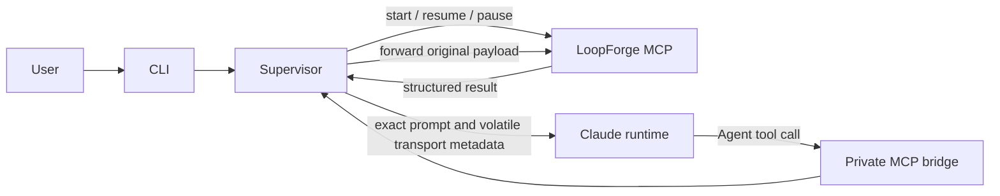

# Architecture

The adapter wraps an existing coding agent. Claude Code is the implemented
host; no Codex driver is included. The TypeScript contracts and tests describe
the executable behavior. This document is a map to that implementation.

## Ownership

| Component | Owns | Source |
| --- | --- | --- |
| LoopForge | Committed rounds, evidence, acceptance, contracts, held prompts, submission handles, recovery and leases | The separately installed LoopForge runtime |
| Coding agent | Semantic judgment, work selection, tools, workspace edits and reported claims | Claude Code and the model |
| Adapter | Host lifecycle, MCP forwarding, context switching and execution ownership | This project |

The adapter does not compile prompts, summarize past work, infer success,
select skills, or learn a working profile. It has no durable history store,
round counter or independent run-lock file. Its in-process queue serializes
operations; LoopForge's leases and transactions protect durable mutations.

## Runtime path

The supervisor owns one LoopForge stdio client for its run. Claude connects
to a private stdio bridge, which reaches the supervisor over a local control
endpoint. Ordinary MCP servers connect directly to Claude from the explicit
MCP configuration. They do not pass through the LoopForge client.

## Invocation boundary

1. Probe host capabilities before starting or resuming a loop.
2. Obtain the held prompt and structured metadata from LoopForge. The
   supervisor retains metadata for context classification and loop/session
   routing; it is never replayed as model memory.
3. Start Claude in the same workspace. The prompt text is passed without
   adapter rewriting. `SessionStart` supplies one fixed host-boundary note;
   dynamic round metadata is excluded because the prompt already carries the
   authoritative context boundary.
   Wait for the current session's `UserPromptSubmit` digest to match the
   pending prompt before returning the invocation or authorizing tools.
4. Forward Agent calls through the private bridge. Start, resume, pause and
   stop remain supervisor-owned and are omitted from the Agent tool list.
5. Classify `loopforge_next` using its structured MCP content and
   `contextMode`, never by reading the prompt's prose.

| Result | Adapter action |
| --- | --- |
| `same_round_retry` | Deliver the original result to the current invocation |
| `fresh_invocation` | Withhold the result from the old invocation and replace its native session |
| Terminal result | Stop the host and print the result for the operator |
| Error or invalid envelope | Deliver the original result; do not invent a context transition |

In `restart` mode, replacement requires confirmed process exit before a new
Claude process starts. In `reuse` mode, the old invocation is suspended, then
native `/clear` must produce `SessionEnd(clear)` for the old session and
`SessionStart(clear)` for a different session in the same workspace. Only then
is the next prompt sent. Both modes then require exact prompt delivery
confirmation. A failed clear or delivery falls back to restart after confirmed
exit in reuse mode. An unconfirmed exit blocks replacement.

The relay computes SHA-256 from the exact UTF-8 `UserPromptSubmit.prompt`
string, without trimming or normalizing newlines, and forwards only its digest.
The runtime compares it with the pending prompt's in-memory digest and binds
the receipt to the active native session. Missing/mismatched receipts and
delivery timeouts keep tools closed and fail the invocation. An old-session
receipt cannot confirm a new delivery, even for identical prompt text.
Later operator messages remain ordinary interactive input.

The receipt proves that Claude's submission hook observed the expected input;
it does not prove provider receipt or model understanding. This transport
digest is not LoopForge's `promptHash`, never enters LoopForge calls or the
Vault, and is not a second prompt/history store. The short PTY input gaps are
delivery pacing; they are never treated as confirmation.

Native Claude session IDs, adapter invocation IDs and LoopForge loop/session
IDs are different identities. A new native session does not reset the
workspace or advance a LoopForge round. LoopForge decides the round/attempt
and the information supplied to it.

## Execution ownership

The hook relay sends session/tool/subagent identifiers, background flags and
prompt digests, not prompt text, tool inputs, results or transcript bodies,
to the lifecycle server. It adds a one-use admission locally to main-Agent
governance calls. The bridge
removes that private field before forwarding the original payload to
LoopForge. This admission is separate from LoopForge's submission handle.

Before `loopforge_next`, foreground tools and subagents must finish; known
uncontained background execution blocks submission. While submission is in
progress, no new tools may start. A child Agent may use foreground tools but
cannot call LoopForge governance tools. The supervisor rechecks invocation
ownership inside its queue before forwarding.

These controls cover host-observed execution. They are not an OS sandbox and
cannot attest arbitrary detached processes or remote jobs.

## Persistence and recovery

The adapter keeps volatile control endpoints, session identities, execution
IDs, pending prompt digests and admissions. Temporary launch settings, MCP
configuration, skill links and optional fixed-capability snapshots are removed
during normal shutdown. Abrupt termination may leave
temporary files. Claude and external services retain their own storage
behavior; the adapter does not copy or replay their transcripts.

After process loss, the CLI resumes by `loopId`, with `invocationLost: true`
unless exact input explicitly overrides it. LoopForge reconstructs the
current invocation from its own durable facts. No adapter state file is
needed. Workspace edits and committed LoopForge history are not deleted.

Explicit `--capability-file` originals are host configuration, not round
memory. `fixed-capabilities.ts` renders their full text, canonical paths and
hashes into a bounded temporary system-background file. Source fingerprints
are rechecked at fresh boundaries; changes require confirmed host restart
before a new capture. There is no discovery from transcripts, semantic
summary, tool-result cache, independent task plan or persisted profile.
LoopForge prompts continue through their existing exact delivery path. The
model-visible host note is invariant across rounds and contains no session or
loop IDs, submission handle, guidance, round facts, or boundary reason. It
identifies the current prompt and live MCP schema as authoritative and states
that the workspace persists across invocations. Metadata stays in the
supervisor for deterministic routing and is not a second cognitive or factual
source. Agent skill selection and native activation remain Agent/host behavior.

## Source map

| File | Responsibility |
| --- | --- |
| [cli.ts](../src/cli.ts) | Arguments, interactive input, pause and resume entrypoints |
| [supervisor.ts](../src/supervisor.ts) | Serialized lifecycle and invocation routing |
| [contracts.ts](../src/host/contracts.ts) | Host interfaces and capability fields |
| [bridge.ts](../src/mcp/bridge.ts), [loopforge-result.ts](../src/mcp/loopforge-result.ts) | Tool routing and envelope classification |
| [bridge-server.ts](../src/mcp/bridge-server.ts), [control.ts](../src/mcp/control.ts), [stdio-client.ts](../src/mcp/stdio-client.ts) | Private bridge and MCP transports |
| [claude.ts](../src/hosts/claude.ts) | Capability probe, MCP launch config and driver |
| [claude-runtime.ts](../src/hosts/claude-runtime.ts) | PTY lifecycle and confirmed session replacement |
| [claude-metadata.ts](../src/hosts/claude-metadata.ts) | Fixed model-visible host context projection |
| [claude-isolation.ts](../src/hosts/claude-isolation.ts) | Operational settings and source skill links |
| [fixed-capabilities.ts](../src/hosts/fixed-capabilities.ts) | Explicit source validation, bounded background and content fingerprints |
| [claude-hook.ts](../src/hosts/claude-hook.ts), [claude-lifecycle.ts](../src/hosts/claude-lifecycle.ts) | Host hook relay and local lifecycle channel |
| [claude-execution.ts](../src/hosts/claude-execution.ts) | Volatile execution tracking and admissions |

See [host integration](./HOST-INTEGRATION.md) for the supported containment
scope and [release checks](./RELEASE-CHECKLIST.md) for validation.
